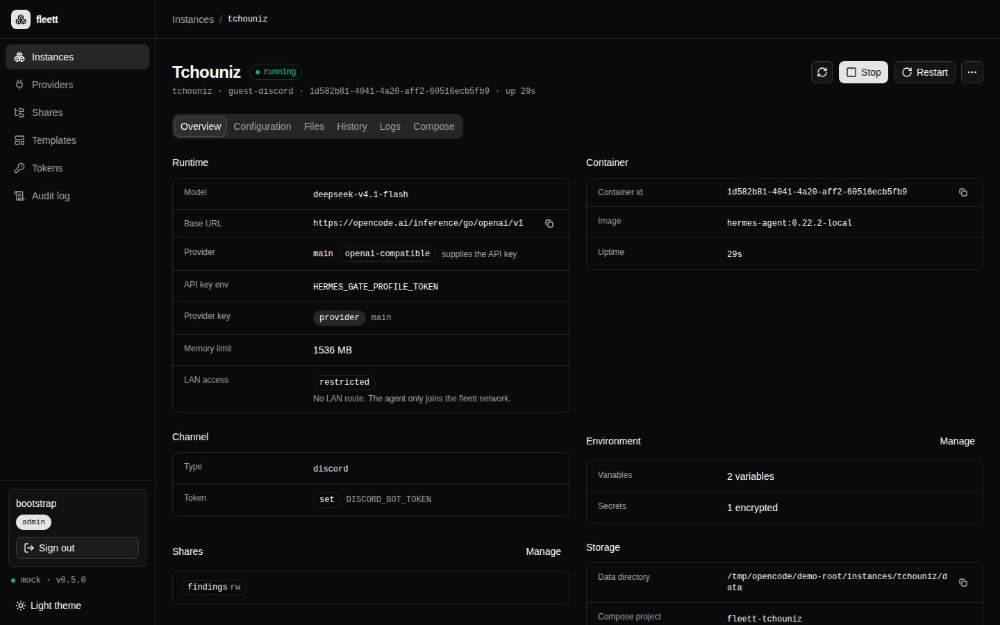
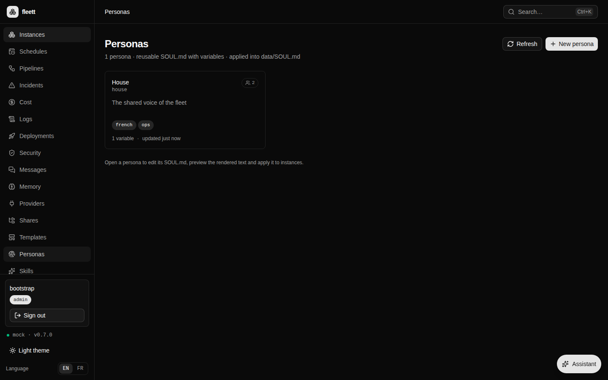
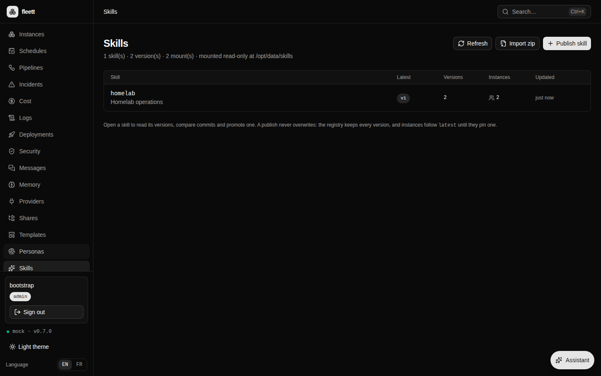
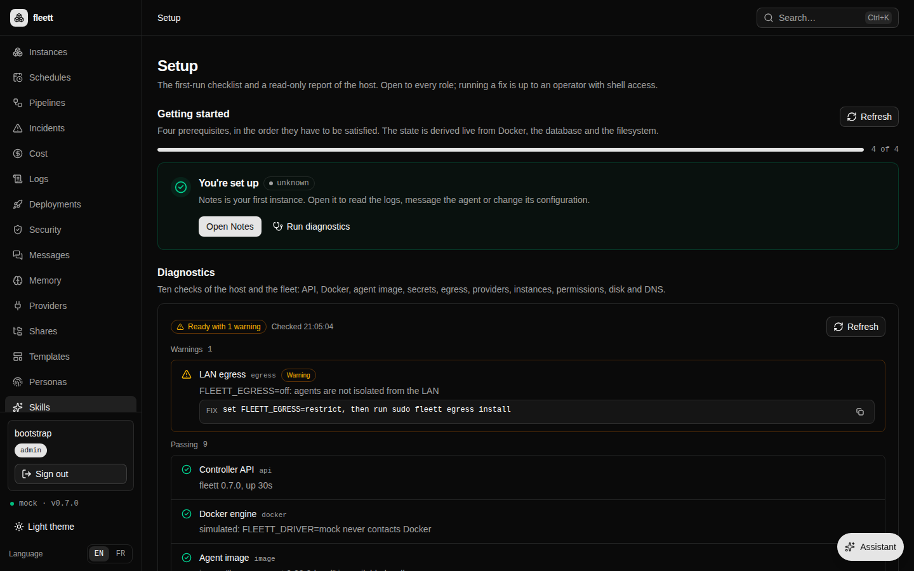
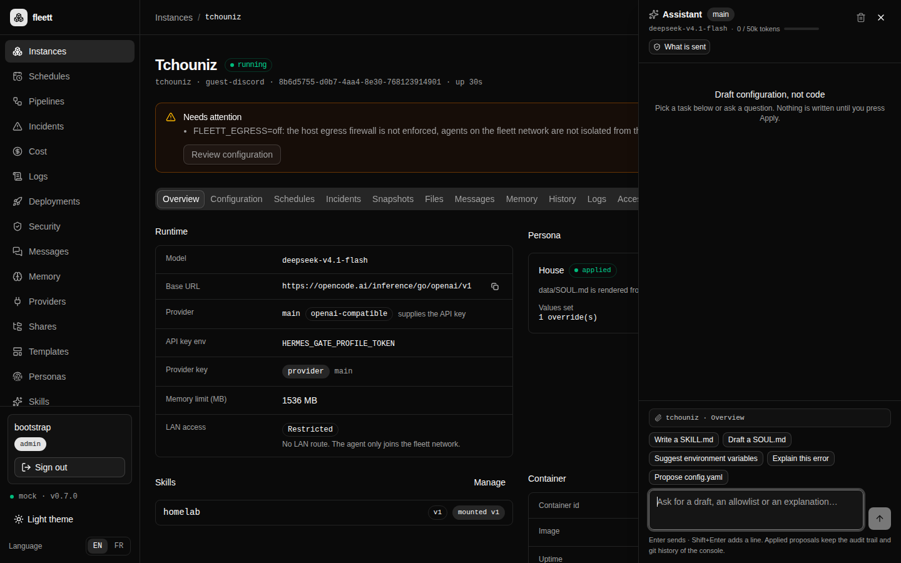

<div align="center">
  
  <h1>fleett</h1>
  <p><strong>A small control plane for fleets of Hermes agents.</strong><br>
  Create, configure, inspect and upgrade each agent in its own Docker container —
  without ever touching the one you already run.</p>

  <p>
    <a href="https://github.com/cleeryy/fleett/actions/workflows/ci.yml"></a>
    <a href="https://github.com/cleeryy/fleett/actions/workflows/compose-integration.yml"></a>
    <a href="https://github.com/cleeryy/fleett/releases"></a>
    <a href="https://github.com/cleeryy/fleett/pkgs/container/fleett"></a>
    
  </p>
</div>


## Why

One agent is easy. Five is not: five configs, five bots, five upgrade paths, five sets of
tokens. `fleett` keeps the part that matters — one Compose project per agent, on disk — and
gives you the rest: a console, a CLI, logs, history, backups and one place to rotate a
credential.

The instance you already run is never touched. `fleett` manages the new ones, side by side.

## Features

| | |
|---|---|
| **Lifecycle** | Create from a template, start, stop, restart, delete (data kept or purged), clone with fresh credentials. |
| **Templates & env** | `guest`, `guest-discord`, `solo`; per-key `secret` flag; encrypted at rest, values never returned; allowlist suggestions. |
| **Providers** | Share one API credential across agents, test it, rotate once and restart every linked agent with a report. |
| **Personas** | Reusable `SOUL.md` templates with variables; assign to any agent, track divergence, reapply in one click. |
| **Skills** | Versioned, read-only skill registry; pin a version per agent or follow `latest`, promote with a rolling restart. |
| **MCP marketplace** | Deploy MCP servers from a catalogue as hardened containers, discover their tools, attach them to agents, supervise health and incidents. |
| **Assistant** | A context-aware panel on every page drafts `SKILL.md`, `SOUL.md`, env allowlists or YAML — with redaction, a token budget and a diff to apply, never a blind write. |
| **Files** | Browse, edit, upload, download and zip; Markdown preview, coloured YAML/JSON, full-text search, ETag conflicts, backups. |
| **History** | One git repo per agent, actor-attributed commits, diff, restore; readable while the agent is stopped. |
| **Logs** | Live SSE follow (with 1 s polling fallback), scroll-pause, filters, 2 000-line buffer, copy/export. |
| **Day two** | Health checks, rolling upgrades with rollback, rotating backups, export/import, usage and quotas. |
| **Security** | OIDC/Authentik with `admin`/`viewer`, CSRF, audit, named tokens, encrypted secrets, egress firewall and destination policies, per-agent LAN opt-in. |
| **Ops** | Doctor + onboarding, Prometheus `/metrics`, `fleett doctor`, compose integration in CI, `.deb`, OCI image. |
| **Console** | Installable PWA, `Ctrl/Cmd+K` palette, full EN/FR, mobile-first at 390 px. |

## Quick start

```bash
curl -fsSL https://raw.githubusercontent.com/cleeryy/fleett/master/install.sh | bash
fleett
# open http://127.0.0.1:8090
```

Linux (static musl, x86_64/aarch64) and macOS (arm64/x86_64). Also published with every
release: a `.deb` (systemd unit, UID 10000, secrets key) and the image
`ghcr.io/cleeryy/fleett`.

<details>
<summary><strong>Debian / Ubuntu</strong></summary>

```bash
curl -fsSLO https://github.com/cleeryy/fleett/releases/latest/download/fleett_0.7.0_amd64.deb
sudo dpkg -i fleett_0.7.0_amd64.deb
sudoedit /etc/fleett/fleett.env   # set FLEETT_TOKEN
sudo systemctl enable --now fleett
```
</details>

<details>
<summary><strong>Container</strong></summary>

```bash
docker run -d --name fleett \
  -p 127.0.0.1:8090:8090 \
  -v /var/run/docker.sock:/var/run/docker.sock \
  -v fleett-data:/data \
  -e FLEETT_TOKEN=change-me \
  -e FLEETT_DRIVER=compose \
  --group-add "$(stat -c '%g' /var/run/docker.sock)" \
  ghcr.io/cleeryy/fleett:0.7.0
```
</details>

The console's **Setup** page walks through the three prerequisites: Docker reachable, the
agent image built (`docker build -t hermes-agent:0.22.2-local /path/to/hermes-official`),
a provider created. The **Doctor** checks the rest.

## A look inside



| | |
|---|---|
|  |  |
| **Personas** — one voice, many agents. | **Skills** — versions, pins, rolling promote. |
|  |  |
| **Setup** — doctor and first-run guide. | **Assistant** — drafts, diffs, audited apply. |

## How it fits together

```
          browser / fleett CLI
                    │  HTTP + OIDC session or bearer token
          ┌─────────▼──────────────────────────────────┐
          │  fleett                                     │
          │  axum · SQLite · files · git · /metrics     │
          │  writes instances/<id>/compose.yaml         │
          └─────────┬───────────────────────────────────┘
                    │  docker compose -p fleett-<id>
          ┌─────────▼───────────────────────────────────┐
          │  Docker                                     │
          │  fleett-tchouniz   fleett-walter   fleett-ops│
          │    /opt/data         /opt/data       …       │
          └─────────────────────────────────────────────┘
```

Each agent is a Compose project on disk with `restart: unless-stopped`. The control plane
only writes files and calls Compose; it supervises no process. Stop it, update it or delete
it — the agents keep running. The SQLite database is a rebuildable index; `instances/` and
`shares/` are the source of truth.

## Security model

- **Agents are contained**: no host network, no Docker socket, one data mount, `NET_RAW`
  dropped, `pids_limit`, memory and CPU limits, optional strict hardening profile.
- **Egress**: the restricted `fleett` network, host `DOCKER-USER` firewall for RFC1918,
  optional per-agent destination policies. A policy that adds nothing over the host firewall
  never renders a proxy; an unreachable proxy is reported, not silently enforced.
- **Secrets**: AES-256-GCM at rest, key outside `FLEETT_ROOT`, Compose only sees `${KEY}`,
  no endpoint returns a secret value. The assistant redacts provider and instance secrets
  before sending context to the model.
- **Humans**: OIDC/Authentik, signed session cookies, `admin`/`viewer`, CSRF double-submit,
  named tokens stored as digests, every mutation in the audit log — including
  “via assistant”.

## CLI

```bash
fleett ls
fleett create --template guest-discord --id tchouniz
fleett logs tchouniz --since 30m --grep error --level error
fleett usage
fleett upgrade --image hermes-agent:0.23.0-local
fleett backup --keep 7
fleett egress policy tchouniz
fleett egress unset tchouniz
fleett doctor
```

Every command accepts `--json`; the server URL and token come from
`~/.config/fleett/config.toml` or `FLEETT_URL` / `FLEETT_TOKEN`.

## Docs

| | |
|---|---|
| [Install](docs/INSTALL.md) · [Deploy](docs/DEPLOY.md) · [Packaging](docs/PACKAGING.md) | run it as a binary, a `.deb` or a container |
| [Security: secrets](docs/SECRETS.md) · [egress](docs/EGRESS.md) · [policies](docs/EGRESS-POLICY.md) · [hardening](docs/HARDENING.md) · [OIDC](docs/OIDC.md) | the guarantees and how to operate them |
| [Files](docs/FILES.md) · [git](docs/GIT.md) · [env](docs/ENV.md) · [providers](docs/PROVIDERS.md) · [personas](docs/PERSONAS.md) · [skills](docs/SKILLS.md) · [MCP servers](docs/MCP-SERVERS.md) · [assistant](docs/ASSISTANT.md) | the per-agent surface |
| [Backup](docs/BACKUP.md) · [upgrade](docs/UPGRADE.md) · [CLI](docs/CLI.md) · [metrics](docs/METRICS.md) · [onboarding](docs/ONBOARDING.md) · [CI](docs/CI.md) | day-two operations |
| [Console i18n](web/I18N.md) | FR/EN conventions and the hardcoded-copy gate |

## Development

```bash
cd backend && cargo run          # mock driver, no Docker calls
cd web && pnpm install && pnpm dev
```

Single binary with the console embedded:

```bash
cd web && pnpm build
cd ../backend && cargo build --release --features embed-web
```

The gates are `cargo test` (923 tests), `cargo clippy --all-targets -- -D warnings`,
`pnpm build` and `node scripts/check-i18n.mjs --strict`. The compose-driver job runs the
real `docker compose` lifecycle against a stand-in agent image on every push.

## Upgrading from `hermes-fleet`

`FLEETT_*` is read first, `FLEET_*` still works, `~/.hermes-fleet` is adopted when
`~/.fleett` is absent, and legacy `hermes-<id>` Compose projects stay manageable. Renaming
the projects themselves is opt-in:

```bash
fleett migrate --from hermes-fleet           # print the plan
fleett migrate --from hermes-fleet --apply   # down, rewrite, up
```
