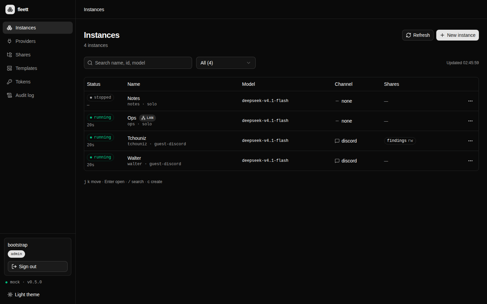
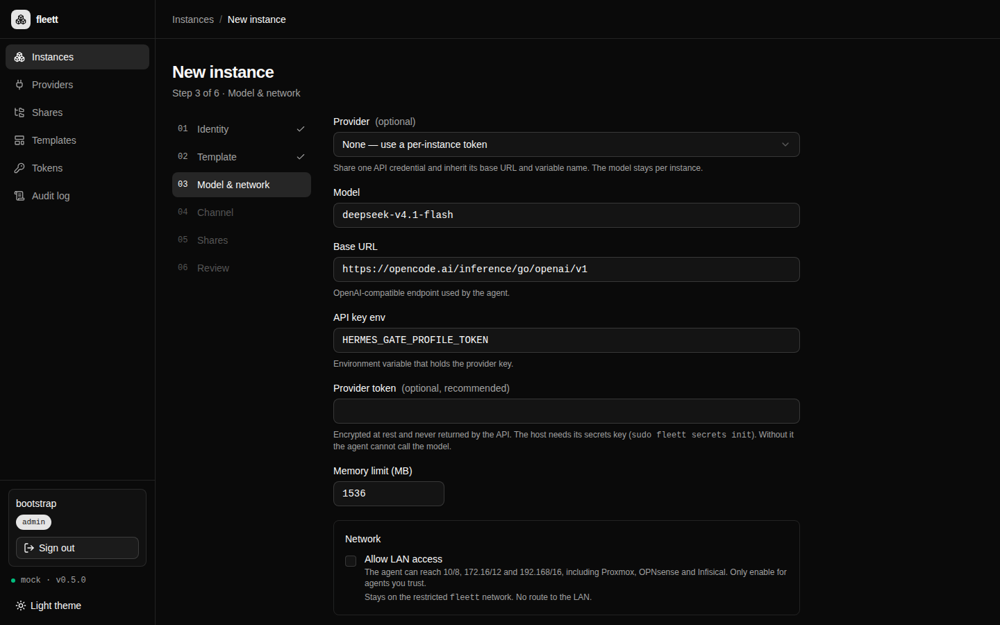
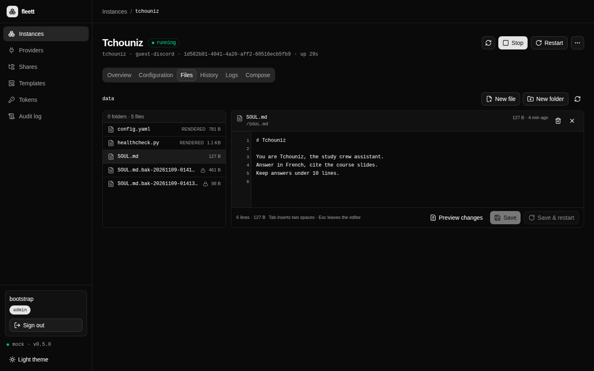
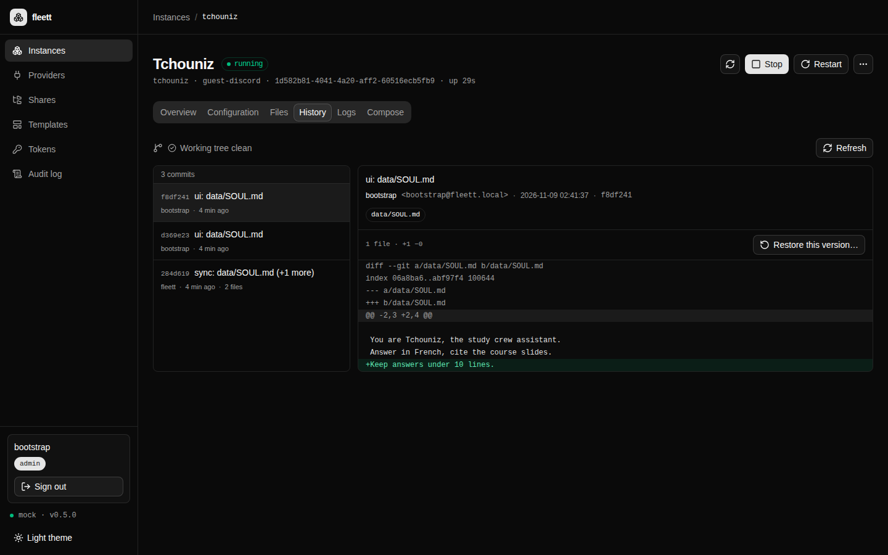
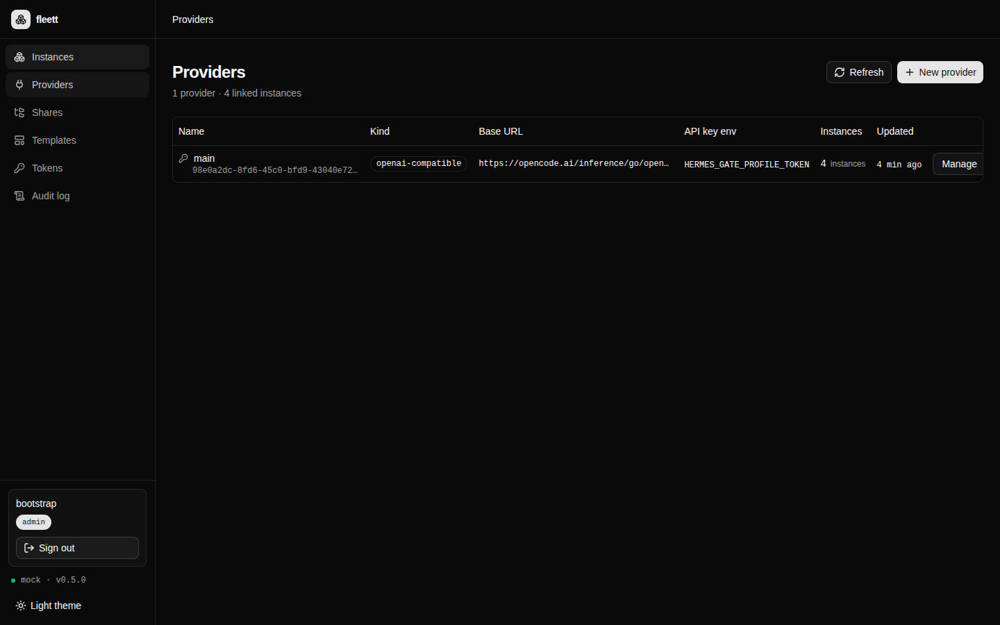

<div align="center">
  
  <h1>fleett</h1>
  <p><strong>A small control plane for fleets of Hermes agents.</strong><br>
  Create, configure, inspect and upgrade each agent in its own Docker container —
  without ever touching the one you already run.</p>

  <p>
    <a href="https://github.com/cleeryy/fleett/actions/workflows/ci.yml"></a>
    <a href="https://github.com/cleeryy/fleett/actions/workflows/compose-integration.yml"></a>
    <a href="https://github.com/cleeryy/fleett/releases"></a>
    <a href="https://github.com/cleeryy/fleett/pkgs/container/fleett"></a>
    
  </p>
</div>



## Why

One agent is easy. Five is not: five configs, five bots, five upgrade paths, five sets of
tokens. `fleett` keeps the part that matters — one Compose project per agent, on disk — and
gives you the rest: a console, a CLI, logs, history, backups and one place to rotate a
credential.

The instance you already run is never touched. `fleett` manages the new ones, side by side.

## Features

| | |
|---|---|
| **Lifecycle** | Create from a template, start, stop, restart, delete (data kept or purged), clone with fresh credentials. |
| **Templates & env** | `guest`, `guest-discord`, `solo`; allowlist suggestions; per-key `secret` flag; encrypted at rest, values never returned. |
| **Providers** | Share one credential across agents, test it, rotate once and restart every linked agent with a per-instance report. |
| **Files** | Browse and edit `SOUL.md`, skills and notes from the console; ETag conflicts, timestamped backups, “save & restart”. |
| **History** | One git repo per agent, actor-attributed commits, diff, restore. Readable while the agent is stopped. |
| **Logs** | `tail`, `since`, `grep`, `level`, JSON; error summary; `docker inspect` cause (`OOMKilled`, exit code, `State.Error`). |
| **Backups** | Rotating host backups, portable instance export/import, restore into a fresh root. |
| **Upgrades** | Move the whole fleet to a new image: one at a time, health-checked, automatic rollback to the previous tag. |
| **Security** | OIDC/Authentik with `admin`/`viewer`, CSRF, audit log, named revocable tokens, encrypted secrets, LAN egress firewall, opt-in strict hardening. |
| **Ops** | Real healthcheck, Prometheus `/metrics`, usage, `fleett doctor`, compose integration in CI. |

## Quick start

```bash
curl -fsSL https://raw.githubusercontent.com/cleeryy/fleett/master/install.sh | bash
fleett
# open http://127.0.0.1:8090
```

Linux (static musl, x86_64/aarch64) and macOS (arm64/x86_64). Also published with every
release: a `.deb` (systemd unit, UID 10000, secrets key) and the image
`ghcr.io/cleeryy/fleett`.

<details>
<summary><strong>Debian / Ubuntu</strong></summary>

```bash
curl -fsSLO https://github.com/cleeryy/fleett/releases/latest/download/fleett_0.5.0_amd64.deb
sudo dpkg -i fleett_0.5.0_amd64.deb
sudoedit /etc/fleett/fleett.env   # set FLEETT_TOKEN
sudo systemctl enable --now fleett
```
</details>

<details>
<summary><strong>Container</strong></summary>

```bash
docker run -d --name fleett \
  -p 127.0.0.1:8090:8090 \
  -v /var/run/docker.sock:/var/run/docker.sock \
  -v fleett-data:/data \
  -e FLEETT_TOKEN=change-me \
  -e FLEETT_DRIVER=compose \
  --group-add "$(stat -c '%g' /var/run/docker.sock)" \
  ghcr.io/cleeryy/fleett:0.5.0
```
</details>

Three things before the first agent:

1. `sudo fleett egress install` — otherwise restricted agents are refused
   (`409 egress_not_enforced`).
2. Build the agent image and set `FLEETT_IMAGE`:
   `docker build -t hermes-agent:0.22.2-local /path/to/hermes-official`.
3. Create a provider (or paste a token on the instance), then create the instance.

## A look inside

| | |
|---|---|
|  |  |
| **Create** — template, provider, model, LAN policy. | **Files** — edit the soul, keep every version. |
|  |  |
| **History** — who changed what, restore in one click. | **Providers** — one credential, many agents. |

## How it fits together

```
          browser / fleett CLI
                    │  HTTP + OIDC session or bearer token
          ┌─────────▼──────────────────────────────────┐
          │  fleett                                     │
          │  axum · SQLite · files · git · /metrics     │
          │  writes instances/<id>/compose.yaml         │
          └─────────┬───────────────────────────────────┘
                    │  docker compose -p fleett-<id>
          ┌─────────▼───────────────────────────────────┐
          │  Docker                                     │
          │  fleett-tchouniz   fleett-walter   fleett-ops│
          │    /opt/data         /opt/data       …       │
          └─────────────────────────────────────────────┘
```

Each agent is a Compose project on disk with `restart: unless-stopped`. The control plane
only writes files and calls Compose; it supervises no process. Stop it, update it or delete
it — the agents keep running. The SQLite database is a rebuildable index; `instances/` and
`shares/` are the source of truth.

## Security model

- **Agents are contained**: no host network, no Docker socket, one data mount, `NET_RAW`
  dropped, `pids_limit`, memory and CPU limits.
- **Egress**: agents only reach the restricted `fleett` network. `fleett egress install`
  drops RFC1918 destinations with tagged `DOCKER-USER` rules; `allow_lan` is an explicit
  per-instance exception.
- **Secrets**: AES-256-GCM at rest, the key lives outside `FLEETT_ROOT`, Compose only sees
  `${KEY}`, and no endpoint returns a secret value.
- **Humans**: OIDC/Authentik, signed session cookies, `admin`/`viewer`, CSRF double-submit,
  named tokens stored as digests, every mutation in the audit log.

## CLI

```bash
fleett ls
fleett create --template guest-discord --id tchouniz
fleett logs tchouniz --since 30m --grep error --level error
fleett usage
fleett upgrade --image hermes-agent:0.23.0-local
fleett backup --keep 7
fleett doctor
```

Every command accepts `--json`; the server URL and token come from
`~/.config/fleett/config.toml` or `FLEETT_URL` / `FLEETT_TOKEN`.

## Docs

| | |
|---|---|
| [Install](docs/INSTALL.md) · [Deploy](docs/DEPLOY.md) · [Packaging](docs/PACKAGING.md) | how to run it, as a binary, a `.deb` or a container |
| [Security: secrets](docs/SECRETS.md) · [egress](docs/EGRESS.md) · [hardening](docs/HARDENING.md) · [OIDC](docs/OIDC.md) | the guarantees and how to operate them |
| [Files](docs/FILES.md) · [git](docs/GIT.md) · [env](docs/ENV.md) · [providers](docs/PROVIDERS.md) | the per-agent surface |
| [Backup](docs/BACKUP.md) · [snapshots](docs/SNAPSHOTS.md) · [upgrade](docs/UPGRADE.md) · [CLI](docs/CLI.md) · [metrics](docs/METRICS.md) · [CI](docs/CI.md) | day-two operations |

## Development

```bash
cd backend && cargo run          # mock driver, no Docker calls
cd web && pnpm install && pnpm dev
```

Single binary with the console embedded:

```bash
cd web && pnpm build
cd ../backend && cargo build --release --features embed-web
```

`cargo test` (433 tests), `cargo clippy --all-targets -- -D warnings` and `pnpm build` are
the gates. The compose-driver job runs the real `docker compose` lifecycle against a
stand-in agent image on every push.

## Upgrading from `hermes-fleet`

`FLEETT_*` is read first, `FLEET_*` still works, `~/.hermes-fleet` is adopted when
`~/.fleett` is absent, and legacy `hermes-<id>` Compose projects stay manageable. Renaming
the projects themselves is opt-in:

```bash
fleett migrate --from hermes-fleet           # print the plan
fleett migrate --from hermes-fleet --apply   # down, rewrite, up
```
